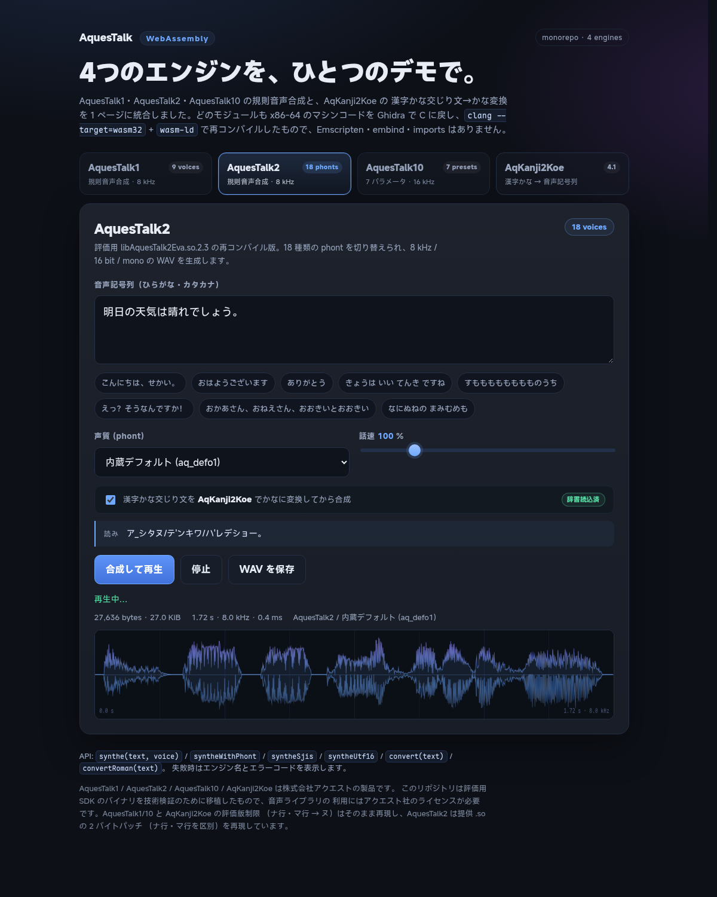

**English** · [中文](README.zh.md)

# AquesTalk WebAssembly monorepo

This repository collects four AQUEST speech components and provides a unified
browser demo:

| Component | Role | Artifact | Voices | Sample rate |
| --- | --- | --- | --- | --- |
| **AquesTalk1** | rule-based speech synthesis | `aquestalk1.wasm` (811 KB) | 9 built-in voices | 8 kHz |
| **AquesTalk2** | rule-based speech synthesis | `aquestalk2-core.wasm` (79 KB) | 18 phonts | 8 kHz |
| **AquesTalk10** | rule-based speech synthesis | `aqtk10.wasm` (362 KB) | 7 presets + 7 parameters | 16 kHz (varies with `fsc`) |
| **AqKanji2Koe** | kanji/kana mixed text to kana/romaji | `aqk2k32.wasm` (232 KB) | — | — |

All four modules were decompiled from x86-64 machine code to C with Ghidra and
recompiled with `clang --target=wasm32` + `wasm-ld` into **bare wasm**: no
Emscripten, no embind, no libc, **0 imports**. The unified demo only performs
string encoding/decoding, memory reads/writes, and WAV copying; it contains no
x86 interpreter or binary translation.



## Quick start

```bash
cd aquestalk-wasm
./scripts/serve.sh
# open http://127.0.0.1:8000/demo/ in a browser
```

`serve.sh` must run from the repository root because the demo references the
wasm, phont, and dictionary files under `engines/<engine>/...` directly. You can
also use:

```bash
python3 -m http.server 8000
```

> Do not open the demo through `file://`: ES modules and `fetch()` require HTTP.

### AqKanji2Koe dictionaries

`aqdic.bin` (9.8 MB) and `lookup.bin` (5.3 MB) are licensed AQUEST data and are
**not committed to git**. The local workspace already has them; if yours does
not, put `aqdic.bin` at:

```
engines/aqk2k/aqk2k_lnx/aq_dic/aqdic.bin
```

Then generate the lookup table (this needs the third-party
`engines/aqk2k/bakak2k` checkout):

```bash
cd engines/aqk2k
node port/tools/gen_lookup.mjs \
  aqk2k_lnx/aq_dic/aqdic.bin \
  aqk2k_lnx/aq_dic/lookup.bin
```

Without the dictionaries the demo still works for AquesTalk1/2/10; the
AqKanji2Koe tab shows "No dictionary".

## Unified demo

`demo/` is based on the AquesTalk2 demo (voice selection, 50-300% speaking
rate, waveform, WAV download) and adds engine switching plus the AqKanji2Koe
text front end. The UI is in English (the sample utterances remain Japanese):

- **AquesTalk1**: 9 built-in voices (f1/f2/m1/m2/r1/imd1/jgr/dvd/f3).
- **AquesTalk2**: 18 phonts, the built-in default plus files in `phont/`.
- **AquesTalk10**: F1/F2/F3/M1/M2/R1/R2 presets, with `bas / vol / pit / acc /
  lmd / fsc` adjustable under `<details>`; the speed slider overrides `spd`.
- **AqKanji2Koe**: kanji/kana mixed text to kana (with accent marks) or romaji;
  one click to play the result with AquesTalk2.
- **Pipeline**: check k2k preprocessing on any synthesis tab and kanji input is
  converted to kana before synthesis; the result appears in the "Reading"
  column.
- On failure the engine name and raw error code are shown; waveform, duration,
  sample rate, and synthesis time are displayed.
- Every engine is loaded on demand; the AqKanji2Koe dictionary is fetched only
  on first use (about 15 MB).

The demo entry point is `demo/index.html`, the adapters live in
`demo/engines.js`, and the UI is in `demo/app.js`.

### Shared kana corpus

`data/kana-corpus.js` is the single TTS corpus shared by the demo and all
headless tests:

- 151 everyday Japanese lines (greetings, weather, food, shopping, transport,
  work, school, family, health, numbers, requests, katakana loanwords, long
  sentences, punctuation, accent/phrase breaks), about 2,600 characters;
- all written directly in kana, so no AqKanji2Koe dictionary is needed;
  AquesTalk1/2/10 all use the same text;
- it also contains hiragana/katakana pairs, evaluation-build probes, invalid
  input, space/sokuon probes, and speaking-rate probes;
- the demo's 8 sample buttons come from this corpus through
  `DEMO_KANA_SAMPLES`, so the samples are not maintained separately.

`data/notation-corpus.js` turns the `音声記号列仕様書` (v1.5) into executable
data: the reading-symbol table, accent marks, phrase-break symbols, devoicing,
nasalized g-row sounds, `NUM`/`NUMK` tags, counters, and romaji notation.

## Layout

```
aquestalk-wasm/
├── engines/
│   ├── aquestalk1/      # original SDK, decompilation, wasm sources, dist, demo
│   ├── aquestalk2/      # same (the UI base of the unified demo)
│   ├── aquestalk10/     # same
│   └── aqk2k/           # AqKanji2Koe sources, wasm32 build, dictionary directory
├── data/                # kana / notation corpus shared by demo and tests
│   ├── kana-corpus.js   # 151 everyday Japanese lines + behavioral probes
│   └── notation-corpus.js # 音声記号列仕様書 v1.5 cases
├── demo/                # unified browser demo
│   ├── index.html
│   ├── style.css
│   ├── app.js
│   └── engines.js       # adapter layer for the four engines
├── scripts/
│   ├── serve.sh
│   ├── test.sh
│   └── build-reloc.sh   # 5 engines .a + Rust host -> dist/aquestalk.wasm
├── link/                # single-memory link kit (ABI, symbol prefixing, host shims, parity)
│   ├── abis/            # public symbol map per engine
│   ├── host/            # Rust malloc/free + C string/stdio/trap
│   ├── tools/           # gen_prefix.py / exports.py / reloc.sh
│   └── test/reloc.mjs   # byte-for-byte parity with the standalone wasm
├── tests/
│   ├── lib/             # temporary HTTP server, WAV parser, voice catalog
│   ├── smoke.mjs        # Node smoke test (no browser)
│   ├── consistency.mjs  # 34 voices x 151 sentences behavioral consistency
│   ├── notation.mjs     # 音声記号列仕様書 v1.5 conformance
│   ├── browser.mjs      # optional Playwright test
│   └── results/         # machine-readable results
├── dist/                # output of ./scripts/build-reloc.sh (git-ignored)
│   └── aquestalk.wasm   # 0 imports, 1 memory single module
├── docs/
│   ├── demo.png
│   ├── consistency-report.md
│   └── notation-report.md
├── package.json
├── NOTICE.md
├── README.md
└── README.zh.md
```

Every `engines/<name>/` keeps its original directory structure, README, NOTICE,
SDK, and git history; the original demos still run standalone from their own
directories.

## Testing

```bash
npm test                 # smoke + consistency + notation
npm run test:consistency # 34 voices x 151 everyday sentences
npm run test:notation    # 音声記号列仕様書 v1.5
npm run test:strict      # strict notation mode: any deviation fails
npm run test:parity      # compare against the original .so (known diffs fail too)
node engines/aqk2k/tests/soak.mjs  # k2k long-session / batch / long-text stress
```

`tests/smoke.mjs` runs a quick smoke test on the shared corpus:

- AquesTalk1 f1/f3, AquesTalk2's built-in phont and `aq_rm.phont`, AquesTalk10
  F1/F3;
- the RIFF/WAVE header, sample rate, and duration of every WAV;
- AqKanji2Koe kana conversion, romaji conversion, 200 consecutive conversions,
  and a 24k-character text;
- the full AqKanji2Koe -> AquesTalk2 pipeline.

`tests/consistency.mjs` runs all 151 lines from `data/kana-corpus.js` through
the **34 voices** of AquesTalk1/2/10 (9 + 18 + 7):

- 5,134 synthesis calls; WAV format/sample rate/duration, byte-for-byte
  determinism, and speaking-rate monotonicity;
- success/failure consistency across the 34 voices, duration correlation, and
  voice distinctness;
- probes for hiragana/katakana, the evaluation-build na/ma-row folding,
  space/sokuon plus question marks, and invalid-input error codes;
- results are written to `tests/results/consistency.json` and
  `docs/consistency-report.md`.

The same everyday corpus and 50-300% speaking-rate probes are also fed to the
original Linux `.so` files (`tests/lib/native_reference.py`, called through
ctypes without modifying the native libraries) for byte-for-byte comparison:

- the everyday corpus is **5120/5134** and the speed probes are **204/204**
  identical to the original `.so`;
- the **14** known differences are all in the accent handling of `prosody-05`
  (`ありがとう'ございます。`): AquesTalk1 f3 plus the 13 external `aq_*.phont`
  voices of AquesTalk2;
- AquesTalk1's `.so` is not in this repository; by default it is read from the
  sibling SDK at `../aquestalk1/aqtk1_lnx/lib64`, or set `AQTK1_LIB64`;
  `REQUIRE_NATIVE=1` makes a missing native library fail;
- `npm run test:parity` also treats the known differences above as failures so
  CI can track the fix.

`tests/notation.mjs` verifies against
`engines/aquestalk2/aqtk2-lnx/siyo_onseikigou.pdf`:

- the 161 reading symbols of section 5 across 34 voices;
- the legal notation of sections 2.2-3.7 and the 17 examples of section 4;
- forbidden combinations in section 3.8, newlines/Tab in section 3.1, and tag
  format in section 3.6;
- the 27 counters of section 6 and romaji of section 7 (AquesTalk2);
- whether accent, devoicing, nasalization, and phrase-break symbols actually
  change the audio;
- results are written to `tests/results/notation.json` and
  `docs/notation-report.md`.

Optional real-browser test:

```bash
npm install --no-save playwright
PLAYWRIGHT_BROWSERS_PATH="$PWD/.playwright-browsers" \
  ./node_modules/.bin/playwright install chromium

./scripts/serve.sh &
node tests/browser.mjs http://127.0.0.1:8000/demo/
```

It clicks the four tabs, synthesizes, converts, enables the pipeline, and writes
screenshots to `.test-artifacts/`.

## Building each engine

The built wasm files are committed, so running the demo does not require a
compiler. Rebuilding only needs LLVM with the wasm32 target (clang + wasm-ld),
not Emscripten:

```bash
cd engines/aquestalk1 && ./recovered/wasm/build.sh
cd engines/aquestalk2 && ./port/build-wasm.sh
cd engines/aquestalk10 && ./port/build-wasm.sh
cd engines/aqk2k && ./port/build_wasm32.sh
```

More detailed generation and parity steps are in each subproject's `README.md`.
Note that AquesTalk10's `port/src/image.c` and AqKanji2Koe's
`aqdic.bin`/`lookup.bin` are generated/licensed data and are not in git.

### Relocatable objects and single-memory packaging

Besides the four standalone wasm files above, every engine can also be built as
a **relocatable `.o`/`.a`** and linked by `wasm-ld` with Rust code into **one
module with one memory**. Browsers do not support multi-memory, so this is the
portable way to embed the engines in a Rust host:

```bash
./scripts/build-reloc.sh          # 5 engines + Rust host -> dist/aquestalk.wasm
npm run test:reloc                # byte-for-byte parity with the standalone wasm
```

- Outputs: `dist/reloc/libaq1.a`, `libaq2.a`, `libaq10.a`, `libaqk2k.a`,
  `libaqusr.a`, `libaqhost.a`, and the single module `dist/aquestalk.wasm`
  (0 imports, 1 memory, 1 table).
- Namespacing: each engine's globals are prefixed at compile time with
  `aq1_`/`aq2_`/..., which avoids collisions between `FUN_0010...`, `aqstr_*`,
  `__cxa_throw`, and similar helpers; the public entry names are listed in
  `link/abis/*.json`.
- Memory: the engines' own `__heap_base` allocators are dropped in favor of
  Rust's global allocator; `malloc`/`free` come from `link/host`, and
  string/stdio/trap helpers come from `aq_host.c`.
- Rust integration (cargo/rust-lld, `--whole-archive`, the export list) is
  described in [link/README.md](link/README.md); Yukw's `aq-wasm` statically
  links the same archives through `AQTK_RELOC_DIR`.

Parity coverage: AquesTalk1 9 voices x 4 sentences x 3 speeds, AquesTalk2 with 4
phonts, AquesTalk10 with 7 presets, AqKanji2Koe kana/romaji, and AqUsrDic Check
plus Import/Export are all byte-identical to the standalone wasm.

## Verification results

Checks shipped with each subproject (see their READMEs):

- AquesTalk2: native and wasm are **512/512** byte-identical; the SHA-256
  regression is 130/130.
- AquesTalk10: **252/252** byte-identical (84 texts x 7 voices x 3 encodings).
- AqKanji2Koe: native **303/303 (100%)**, wasm32 **303/303**, common corpus
  **11/11**.
- AquesTalk1: multi-voice parity with the Linux SDK passes.

This repository additionally:

- fixes the 16-byte table stride of `AqKanji2Koe_ConvRoman` on wasm32 (wasm32
  pointers are 4 bytes, while the decompiled code used the LP64 8-byte stride
  and walked off the table). After the fix `音声合成テスト。` ->
  `onnse-go-se-te'_suto.`, matching the native 64-bit library.
- provides the shared kana corpus: **151 everyday lines x 34 voices = 5,134
  successful syntheses**, with WAV format, sample rate, determinism, and
  50-300% speed monotonicity all passing; see
  [consistency-report.md](docs/consistency-report.md).
- compares byte-for-byte with the original `.so`: **5120/5134** everyday lines
  and **204/204** speed probes match; there are 14 known differences (the
  `prosody-05` accent plus AQ1 f3 / AQ2 external phonts) and no other unexpected
  differences; see [consistency-report.md](docs/consistency-report.md).
- 音声記号列仕様書 v1.5: **161 reading symbols x 34 voices = 5,474** all
  accepted; all 20 legal notations accepted; all 27 counters pass for
  AquesTalk1/10, while AquesTalk2 has a few phont-related 106 errors; see
  [notation-report.md](docs/notation-report.md).
- AqKanji2Koe's `<NUMK VAL="..." COUNTER="...">` / `<NUM VAL="...">` number
  tags, sentence-final punctuation, conjunctions, and accent positions now
  match the original library: the 303-case differential corpus is
  byte-identical.
- AqKanji2Koe's wasm32 runtime uses a segmented free list instead of an arena,
  so long sessions and large batches can reuse one instance;
  `engines/aqk2k/tests/soak.mjs` verifies 3,030 consecutive conversions, a
  24k-character text, handle rebuilding, and the memory cap.
- `tests/smoke.mjs`, `tests/consistency.mjs`, `tests/notation.mjs`, and the
  Playwright browser test cover the four tabs, the k2k pipeline, the everyday
  corpus, and the notation specification.

## Known limitations

- AquesTalk1, AquesTalk10, and AqKanji2Koe are **evaluation builds**: the na row
  and ma row map to nu. AquesTalk2's `.so` and `.bak` differ by two bytes; that
  patch makes the "na row / ma row -> nu" mapping unreachable, so AquesTalk2
  distinguishes them normally (see `engines/aquestalk2/README.md`). The demo
  does not accept development/usage license keys and does not bypass the
  restriction. For production behavior, buy the appropriate license from AQUEST
  and call `AquesTalk_SetDevKey` / `AqKanji2Koe_SetDevKey`.
- AqKanji2Koe's wasm32 build uses a recyclable segmented free list by default;
  `AQK2K_LEAK=1` still switches back to a short-lived bump arena. A single very
  long text (tens of thousands of characters) is CPU-intensive; 24k and 72k
  characters have been tested without crashing, but very long text should be
  split into paragraphs.
- AquesTalk1's f3 uses a separate recompiled f3 engine (a different sound-symbol
  vocabulary).
- The only known byte difference between this wasm and the original `.so` is the
  accent path of `prosody-05` (`ありがとう'ございます。`): AQ1 f3 and the 13
  external `aq_*.phont` voices of AQ2 produce the same length but different
  bytes; all other everyday lines and all speed probes match byte-for-byte. The
  difference is tracked by `npm run test:parity` and the consistency report.
- Safari does not support memory64, so AqKanji2Koe uses a wasm32 build (keeping
  the LP64 field layout).

## History and license

The four subprojects were imported into `engines/` with `git subtree`, and their
commit histories are preserved. The commits at the repository root only contain
the monorepo scaffolding, the unified demo, and integration fixes. The original
standalone repositories still exist in the parent directory and were not
modified.

AquesTalk1/2/10 and AqKanji2Koe are commercial software from AQUEST Corp. The
binaries, phonts, dictionaries, and decompiled derivative code in this
repository are subject to their licenses; the repository is for technical
validation and interoperability research only and grants no right to use,
distribute, or commercially run them. See `NOTICE.md` and the license PDFs in
each subproject's SDK directory.
