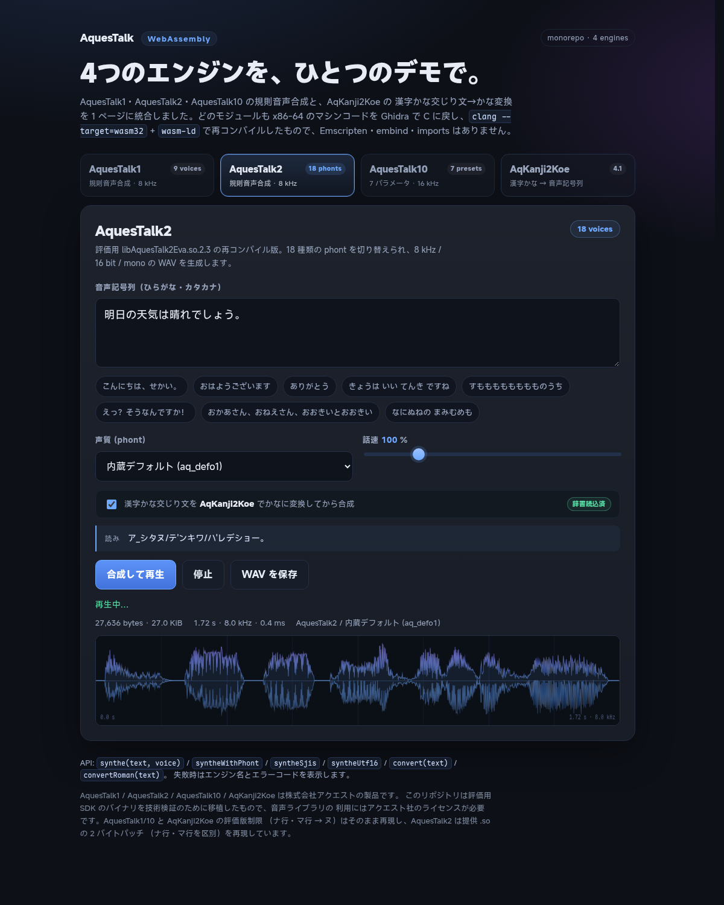

[English](README.md) · **中文**

# AquesTalk WebAssembly monorepo

把 AQUEST 的四个语音组件收进一个仓库，并提供一个统一的浏览器 demo：

| 组件 | 作用 | 产物 | 声质 | 采样率 |
| --- | --- | --- | --- | --- |
| **AquesTalk1** | 规则语音合成 | `aquestalk1.wasm` (811 KB) | 9 个内置声库 | 8 kHz |
| **AquesTalk2** | 规则语音合成 | `aquestalk2-core.wasm` (79 KB) | 18 个 phont | 8 kHz |
| **AquesTalk10** | 规则语音合成 | `aqtk10.wasm` (362 KB) | 7 个预设 + 7 个参数 | 16 kHz（随 `fsc` 变化） |
| **AqKanji2Koe** | 汉字假名混合文 → 假名/罗马字 | `aqk2k32.wasm` (232 KB) | — | — |

四个模块都是从 x86-64 机器码经 Ghidra 反编译成 C，再由
`clang --target=wasm32` + `wasm-ld` 重新编译的 **裸 wasm**：没有 Emscripten、
没有 embind、没有 libc、**imports 为 0**。统一 demo 只是字符串编解码、内存读写和
WAV 拷贝，不包含任何 x86 解释器或二进制翻译。



## 快速开始

```bash
cd aquestalk-wasm
./scripts/serve.sh
# 浏览器打开 http://127.0.0.1:8000/demo/
```

`serve.sh` 必须在仓库根目录起服务，因为 demo 直接引用
`engines/<engine>/...` 下的 wasm、phont 和词典。也可以：

```bash
python3 -m http.server 8000
```

> 不要用 `file://` 直接打开：ES module 和 `fetch()` 都需要 HTTP。

### AqKanji2Koe 词典

`aqdic.bin`（9.8 MB）和 `lookup.bin`（5.3 MB）是 AQUEST 的授权数据，**不提交到
git**。本机工作区里已经有了；如果没有，把 `aqdic.bin` 放到：

```
engines/aqk2k/aqk2k_lnx/aq_dic/aqdic.bin
```

然后生成查找表（需要 `engines/aqk2k/bakak2k` 这个第三方 checkout）：

```bash
cd engines/aqk2k
node port/tools/gen_lookup.mjs \
  aqk2k_lnx/aq_dic/aqdic.bin \
  aqk2k_lnx/aq_dic/lookup.bin
```

缺词典时 demo 仍可正常使用 AquesTalk1/2/10，AqKanji2Koe 标签会显示 “No dictionary”。

## 统一 demo

`demo/` 以 AquesTalk2 的 demo 为底（声质选择、50–300% 话速、波形、WAV 下载），
加上引擎切换和 AqKanji2Koe 文本前端；界面文案为英文（示例语音仍是日文）：

- **AquesTalk1**：9 个内置声库（f1/f2/m1/m2/r1/imd1/jgr/dvd/f3）。
- **AquesTalk2**：18 个 phont，内置默认 + `phont/` 文件。
- **AquesTalk10**：F1/F2/F3/M1/M2/R1/R2 预设，`<details>` 里可调
  `bas / vol / pit / acc / lmd / fsc`；话速滑块覆盖 `spd`。
- **AqKanji2Koe**：汉字假名混合文 → 假名（带アクセント记号）或罗马字；
  可一键用 AquesTalk2 播放。
- **流水线**：在任意合成标签勾选 k2k 预处理，输入汉字文本会先转成假名再合成，
  转换结果显示在 “Reading” 栏。
- 合成失败时显示引擎名和原始错误码；波形、时长、采样率、合成耗时都会显示。
- 所有引擎按需加载；AqKanji2Koe 词典只在第一次用到时拉取（约 15 MB）。

demo 的入口是 `demo/index.html`，适配器在 `demo/engines.js`，UI 在
`demo/app.js`。

### 统一 kana 数据集

`data/kana-corpus.js` 是 demo 和所有无头测试共用的唯一 TTS 语料：

- 151 条日常日语（问候、天气、饮食、购物、交通、工作、学校、家庭、健康、
  数字、请求、片假名外来语、长句、标点、アクセント/句切），约 2600 字；
- 全部直接写成假名，不需要 AqKanji2Koe 词典；AquesTalk1/2/10 使用同一份文本；
- 另有平/片假名对、评价版探针、无效输入、空格/促音探针、语速探针；
- demo 的 8 个示例按钮通过 `DEMO_KANA_SAMPLES` 从这份语料取，不再单独维护。

`data/notation-corpus.js` 把 `音声記号列仕様書`（v1.5）转成可执行数据：
読み記号表、アクセント、句切記号、無声化、ガ行鼻濁音、`NUM`/`NUMK` 标签、
助数词和ローマ字表記。

## 目录

```
aquestalk-wasm/
├── engines/
│   ├── aquestalk1/      # 原始 SDK、反编译、wasm 源、dist、原 demo
│   ├── aquestalk2/      # 同上（统一 demo 的 UI 基础）
│   ├── aquestalk10/     # 同上
│   └── aqk2k/           # AqKanji2Koe 源、wasm32 构建、词典目录
├── data/                # demo 和测试共用的 kana / 記号列语料
│   ├── kana-corpus.js   # 151 条日常日语 + 行为探针
│   └── notation-corpus.js # 音声記号列仕様書 v1.5 用例
├── demo/                # 统一前端 demo
│   ├── index.html
│   ├── style.css
│   ├── app.js
│   └── engines.js       # 四个引擎的统一适配层
├── scripts/
│   ├── serve.sh
│   ├── test.sh
│   └── build-reloc.sh   # 5 个引擎 .a + Rust host -> dist/aquestalk.wasm
├── link/                # 单内存链接套件（ABI、符号前缀、host shim、对拍）
│   ├── abis/            # 每个引擎的公开符号映射
│   ├── host/            # Rust malloc/free + C string/stdio/trap
│   ├── tools/           # gen_prefix.py / exports.py / reloc.sh
│   └── test/reloc.mjs   # 与原独立 wasm 逐字节对拍
├── tests/
│   ├── lib/             # 临时 HTTP 服务、WAV 解析、声库目录
│   ├── smoke.mjs        # Node 冒烟测试（无浏览器）
│   ├── consistency.mjs  # 34 声库 × 151 句行为一致性
│   ├── notation.mjs     # 音声記号列仕様書 v1.5 符合性
│   ├── browser.mjs      # 可选 Playwright 测试
│   └── results/         # 机器可读结果
├── dist/                # ./scripts/build-reloc.sh 的产物（git 忽略）
│   └── aquestalk.wasm   # 0 imports、1 memory 的单模块
├── docs/
│   ├── demo.png
│   ├── consistency-report.md
│   └── notation-report.md
├── package.json
├── NOTICE.md
├── README.md
└── README.zh.md
```

每个 `engines/<name>/` 保留原来的目录结构、README、NOTICE、SDK 和 git 历史，
原有 demo 仍然可以在各自目录下单独运行。

## 测试

```bash
npm test                 # smoke + consistency + notation
npm run test:consistency # 34 个声库 × 151 条日常语料
npm run test:notation    # 音声記号列仕様書 v1.5
npm run test:strict      # notation 的严格模式：任何规范偏差都失败
npm run test:parity      # 与原始 .so 对拍（含已知差异也失败）
node engines/aqk2k/tests/soak.mjs  # k2k 长会话 / 大批量 / 长文压力测试
```

`tests/smoke.mjs` 用共享语料做快速冒烟：

- AquesTalk1 f1/f3、AquesTalk2 内置 phont 和 `aq_rm.phont`、AquesTalk10 F1/F3；
- 每个 WAV 的 RIFF/WAVE 头、采样率、时长；
- AqKanji2Koe 假名转换、罗马字转换、连续 200 次转换和 24k 字长文；
- AqKanji2Koe → AquesTalk2 的完整流水线。

`tests/consistency.mjs` 把 `data/kana-corpus.js` 的全部 151 条语料跑过
AquesTalk1/2/10 的 **34 个声库**（9 + 18 + 7）：

- 5134 次合成；WAV 格式/采样率/时长、逐字节确定性、语速单调性；
- 34 个声库的成功/失败一致性、时长相关性、声库区分度；
- 平/片假名、评价版ナ/マ行折叠、空格/促音+疑问符、无效输入错误码等探针；
- 结果写到 `tests/results/consistency.json` 和 `docs/consistency-report.md`。

同一批日常语料和 50–300% 语速探针还会送进原始 Linux `.so`
（`tests/lib/native_reference.py`，ctypes 调用，不修改原生库）逐字节对拍：

- 日常语料 **5120/5134**、语速 **204/204** 与原始 `.so` 完全一致；
- 已知差异 **14** 个，全部集中在 `prosody-05`（`ありがとう'ございます。`）
  的アクセント处理：AquesTalk1 f3 + AquesTalk2 的 13 个外部 `aq_*.phont`；
- AquesTalk1 的 `.so` 不在本仓库，默认从相邻 SDK
  `../aquestalk1/aqtk1_lnx/lib64` 读取，也可用 `AQTK1_LIB64` 指定；
  设置 `REQUIRE_NATIVE=1` 时缺少原生库会失败；
- `npm run test:parity` 会把上述已知差异也当作失败，便于 CI 跟踪修复。

`tests/notation.mjs` 按 `engines/aquestalk2/aqtk2-lnx/siyo_onseikigou.pdf`
验证：

- section 5 的 161 个読み記号 × 34 声库；
- section 2.2–3.7 的合法记法、section 4 的 17 个示例；
- section 3.8 的禁止组合、section 3.1 的换行/Tab、section 3.6 的标签格式；
- section 6 的 27 个助数词、section 7 的ローマ字（AquesTalk2）；
- アクセント/無声化/鼻濁音/句切記号是否真的改变音频；
- 结果写到 `tests/results/notation.json` 和 `docs/notation-report.md`。

可选的真实浏览器测试：

```bash
npm install --no-save playwright
PLAYWRIGHT_BROWSERS_PATH="$PWD/.playwright-browsers" \
  ./node_modules/.bin/playwright install chromium

./scripts/serve.sh &
node tests/browser.mjs http://127.0.0.1:8000/demo/
```

它会点击四个标签、合成、转换、勾选流水线，并把截图写到 `.test-artifacts/`。

## 各自构建

已构建的 wasm 已提交，直接跑 demo 不需要编译。重新构建时只需要带 wasm32 目标的
LLVM（clang + wasm-ld），不需要 Emscripten：

```bash
cd engines/aquestalk1 && ./recovered/wasm/build.sh
cd engines/aquestalk2 && ./port/build-wasm.sh
cd engines/aquestalk10 && ./port/build-wasm.sh
cd engines/aqk2k && ./port/build_wasm32.sh
```

更细的生成/对拍步骤见各子项目的 `README.md`。注意 AquesTalk10 的
`port/src/image.c` 和 AqKanji2Koe 的 `aqdic.bin`/`lookup.bin` 是生成/授权数据，
不在 git 里。

### 可重定位对象与单内存打包

除了上面四个独立 wasm，每个引擎还能构建成**可重定位的 `.o`/`.a`**，由
`wasm-ld` 和 Rust 代码链接进**同一个模块、同一块内存**——浏览器不支持
multi-memory，这是把引擎嵌进 Rust 宿主的唯一可移植方式：

```bash
./scripts/build-reloc.sh          # 5 个引擎 + Rust host -> dist/aquestalk.wasm
npm run test:reloc                # 与原独立 wasm 逐字节对拍
```

- 产物：`dist/reloc/libaq1.a`、`libaq2.a`、`libaq10.a`、`libaqk2k.a`、
  `libaqusr.a`、`libaqhost.a` 和单模块 `dist/aquestalk.wasm`（0 imports、
  1 个 memory、1 个 table）。
- 命名空间：每个引擎的全局符号在编译期加上 `aq1_`/`aq2_`/… 前缀，避免
  `FUN_0010…`、`aqstr_*`、`__cxa_throw` 等重名；公开入口名见
  `link/abis/*.json`。
- 内存：去掉各引擎自带的 `__heap_base` 分配器，统一用 Rust 的全局分配器；
  `malloc`/`free` 由 `link/host` 提供，字符串/stdio/trap 由 `aq_host.c` 提供。
- Rust 侧接入方式（`cargo`/rust-lld、`--whole-archive`、导出清单）见
  [link/README.md](link/README.md)；Yukw 的 `aq-wasm` 通过 `AQTK_RELOC_DIR`
  直接静态链接同一套归档。

对拍覆盖：AquesTalk1 9 声库 × 4 句 × 3 语速、AquesTalk2 4 个 phont、
AquesTalk10 7 个预设、AqKanji2Koe 假名/罗马字、AqUsrDic Check 与
Import/Export，全部与原来的独立 wasm 字节一致。

## 验证结果

各子项目自带的验证（详见各自 README）：

- AquesTalk2：原生与 wasm 各 **512/512** 逐字节一致；SHA-256 回归 130/130。
- AquesTalk10：**252/252** 逐字节一致（84 句 × 7 声种 × 3 编码）。
- AqKanji2Koe：原生 **303/303 (100%)** 完全一致；wasm32 全量语料 **303/303**，公共语料 **11/11**。
- AquesTalk1：与 Linux SDK 的多声库对拍通过。

本仓库额外做了：

- 修复 wasm32 下 `AqKanji2Koe_ConvRoman` 的 16 字节表步长问题（wasm32 指针是
  4 字节，反编译代码按 LP64 的 8 字节步长走会错位）。修复后
  `音声合成テスト。` → `onnse-go-se-te'_suto.`，与原生 64 位库一致。
- 统一 kana 数据集：**151 条日常日语 × 34 个声库 = 5134 次合成全部成功**，
  WAV 格式、采样率、确定性和 50–300% 语速单调性均通过；详见
  [consistency-report.md](docs/consistency-report.md)。
- 与原始 `.so` 逐字节对拍：**5120/5134** 条日常语料、**204/204** 个语速探针一致；
  已知差异 14 个（`prosody-05` 的アクセント + AQ1 f3 / AQ2 外部 phont），
  无其他意外差异；详见 [consistency-report.md](docs/consistency-report.md)。
- 音声記号列仕様書 v1.5：**161 个読み記号 × 34 声库 = 5474 次全部接受**；
  20 个合法记法全部接受；27 个助数词在 AquesTalk1/10 全通过，AquesTalk2
  有少量 phont 相关的 106 错误；详见
  [notation-report.md](docs/notation-report.md)。
- AqKanji2Koe 的 `<NUMK VAL="…" COUNTER="…">` / `<NUM VAL="…">` 数字标签、
  句末标点、连词与重音位置已对齐原库：303 条差分语料逐字节一致。
- AqKanji2Koe 的 wasm32 运行时改用分段 free list（不再使用 arena），
  长会话与大批量输入可复用同一实例；`engines/aqk2k/tests/soak.mjs`
  验证 3030 次连续转换、24k 字长文、句柄重建和内存上限。
- `tests/smoke.mjs`、`tests/consistency.mjs`、`tests/notation.mjs` 和
  Playwright 浏览器测试覆盖四个标签、k2k 流水线、日常语料和記号列规范。

## 已知限制

- AquesTalk1、AquesTalk10、AqKanji2Koe 是**评价版**：ナ行/マ行 → ヌ。AquesTalk2
  提供的 `.so` 与 `.bak` 只差 2 字节，该补丁让「ナ行/マ行 → ヌ」的映射不可达，
  因此 AquesTalk2 会正常区分（详见 `engines/aquestalk2/README.md`）。demo 不提供
  开发/使用许可证密钥输入，也没有绕过限制。需要产品行为请向 AQUEST 购买相应
  许可证并调用 `AquesTalk_SetDevKey` / `AqKanji2Koe_SetDevKey`。
- AqKanji2Koe 的 wasm32 构建默认使用可回收的分段 free list；`AQK2K_LEAK=1`
  仍可切回短生命周期的 bump arena。单次超长文本（数万字）是 CPU 密集型，
  已测到 24k 字、72k 字不崩溃；极长文本建议按段落切分。
- AquesTalk1 的 f3 使用独立的 recompiled f3 引擎（另一套音声记号词汇）。
- 当前 wasm 与原始 `.so` 的唯一已知字节差异是 `prosody-05`
  （`ありがとう'ございます。`）的アクセント路径：AQ1 f3 与 AQ2 的 13 个
  外部 `aq_*.phont` 输出长度相同但字节不同；其余日常语料和全部语速探针
  逐字节一致。该差异已纳入 `npm run test:parity` 与一致性报告。
- Safari 不支持 memory64，因此 AqKanji2Koe 使用 wasm32 构建（保留 LP64 字段
  布局）。

## 历史与许可

四个子项目通过 `git subtree` 导入到 `engines/`，各自的提交历史完整保留；仓库
根部的提交只包含 monorepo 脚手架、统一 demo 和集成修复。原来的独立仓库仍在
上一级目录中，未改动。

AquesTalk1/2/10 与 AqKanji2Koe 是株式会社アクエスト（AQUEST Corp.）的商用软件。
本仓库中的二进制、phont、词典及其反编译派生代码均受其许可约束；仓库仅用于
技术验证/互操作性研究，不授予任何使用、分发或商业运行许可。详见 `NOTICE.md`
以及各子项目 SDK 目录下的许可证 PDF。
